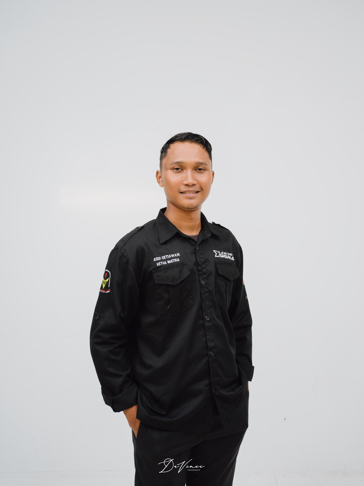
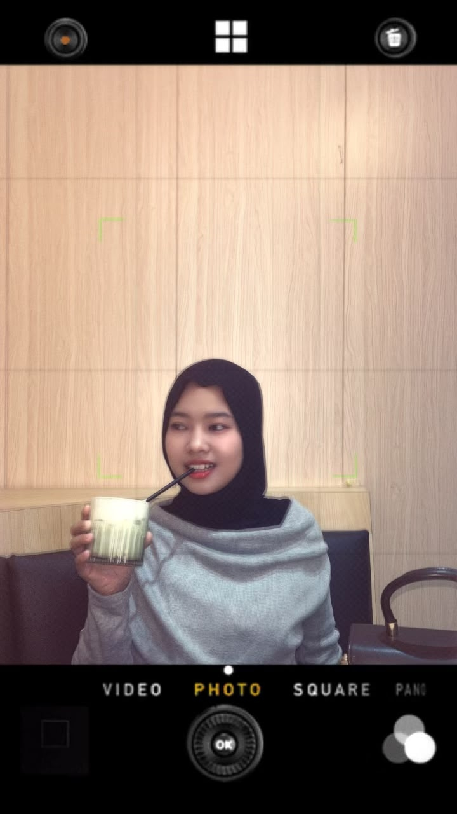

# RuangMedia — panduan pemula

Website pusat media pembelajaran statis dengan HTML, CSS, dan JavaScript. Tidak membutuhkan framework, database, atau proses build.

## 1. Menjalankan website di komputer

1. Ekstrak `RuangMedia.zip`.
2. Buka folder `RuangMedia` menggunakan Visual Studio Code.
3. Buka `index.html` di browser untuk pratinjau sederhana.
4. Untuk pengalaman pengembangan yang lebih nyaman, instal ekstensi **Live Server** di VS Code, klik kanan `index.html`, lalu pilih **Open with Live Server**.

Google Fonts dipakai untuk mempercantik tampilan jika internet tersedia. Jika offline, website tetap memakai font cadangan.

## 2. Menambahkan media HTML milik Anda

Contoh struktur media:

```text
media/
└── matematika/                         # Mata Pelajaran
    └── teorema-pythagoras/             # BAB
        └── tp-1/                       # Tujuan Pembelajaran
            └── simulasi-konsep/        # Satu media HTML
                ├── index.html
                ├── style.css
                ├── script.js
                └── images/
```

Salin **seluruh folder** media asli, bukan hanya file HTML-nya. Pertahankan hubungan folder untuk gambar, audio, video, CSS, dan JavaScript.

Kemudian buka `js/media.js`. Ubah objek contoh, terutama:
- `id`: ID unik, tanpa spasi (contoh `game-pythagoras`)
- `title`: judul media
- `subject`: nama mata pelajaran
- `chapter`: nama BAB
- `tp`: nama/keterangan Tujuan Pembelajaran
- `level`: jenjang atau kelas
- `type`: tipe media
- `description`: deskripsi singkat
- `path`: lokasi file HTML relatif dari `index.html`
- `thumbnail`: lokasi gambar sampul; gunakan `""` jika tidak ada
- `color` dan `icon`: gaya ilustrasi kartu bawaan

Contoh:
```js
{
  id: "game-pythagoras",
  title: "Game Teorema Pythagoras",
  subject: "Matematika",
  chapter: "Teorema Pythagoras",
  tp: "TP 1 — Memahami konsep dan hubungan sisi segitiga siku-siku",
  level: "Kelas VIII",
  type: "Game interaktif",
  description: "Latihan memahami teorema Pythagoras.",
  path: "media/matematika/game-pythagoras/index.html",
  thumbnail: "assets/images/game-pythagoras.webp",
  color: "mint",
  icon: "triangle"
}
```

**Perhatikan:** path peka terhadap huruf besar/kecil pada banyak layanan hosting. Pastikan nama folder dan file sama persis. Mata pelajaran, BAB, dan TP akan muncul otomatis dari data media. Untuk menaruh beberapa media dalam TP yang sama, buat beberapa objek dengan nilai `subject`, `chapter`, dan `tp` yang sama, tetapi `id` dan `path` yang berbeda. Pencarian juga mencakup judul, BAB, TP, jenis media, dan deskripsi.

## 3. Mengganti media contoh

`js/media.js` berisi tujuh entri demonstrasi. Dua media contoh berada pada TP yang sama untuk menunjukkan bahwa satu TP dapat memiliki beberapa media HTML. Path contoh belum menunjuk ke file media nyata kecuali Anda membuat file pada lokasi tersebut. Ganti entri contoh dengan data media milik Anda, atau tambahkan file media yang cocok pada folder yang dirujuk.

## 4. Mengubah warna dan gaya

Buka `css/style.css`. Di bagian awal, variabel warna ada pada `:root`, misalnya:
```css
--navy:#173b57;
--teal:#167d78;
--paper:#f6f8f9;
```
Mengubah variabel ini adalah cara termudah menyesuaikan identitas visual.

## 5. Cara kerja pemutar media

Tombol “Buka media” memuat file di dalam `iframe`. Tombol “Buka tab baru” membuka file HTML langsung. Beberapa media mungkin tidak cocok dengan `iframe`, terutama yang bergantung pada jalur relatif, penyimpanan browser, popup, atau layanan eksternal. Uji media satu per satu setelah dipindahkan.

## 6. Publikasi gratis melalui GitHub Pages

1. Buat akun GitHub jika belum punya.
2. Buat repository baru, misalnya `ruangmedia`.
3. Unggah seluruh isi folder proyek (jangan mengunggah file ZIP saja).
4. Buka **Settings → Pages** pada repository.
5. Di bagian build/deployment, pilih publikasi dari branch utama (biasanya `main`) dan folder root `/`.
6. Simpan pengaturan dan tunggu proses publikasi selesai. GitHub akan menampilkan URL website.
7. Buka URL tersebut dan uji semua media, gambar, pencarian, serta tampilan mobile.

Dokumentasi resmi: https://docs.github.com/en/pages/getting-started-with-github-pages

## 7. Sebelum dipublikasikan

- Uji setiap media dari website lokal dan URL publik.
- Pastikan tidak ada file pendukung yang tertinggal.
- Jangan masukkan data pribadi siswa.
- Ingat bahwa website publik dapat diakses siapa saja.
- Jika file media sangat besar, pertimbangkan batas ukuran dan kuota layanan hosting.

## Isi proyek

- `index.html` — struktur halaman
- `css/style.css` — desain dan responsivitas
- `js/media.js` — daftar media yang mudah diubah
- `js/app.js` — pencarian, filter, navigasi, dan pemutar
- `media/` — tempat menaruh file media pembelajaran Anda
- `assets/` — tempat gambar sampul dan aset pendukung


## 8. Mengisi menu Identitas

Menu **Identitas** menampilkan data pengembang, institusi, dan keterangan tugas Seminar PPG. Identitas yang tercantum saat ini:
- **Asep Setiawan, S.Pd.** — NIM `PPG250429111274`, Program Studi Matematika
- **Sri Hastuti, S.Pd** — NIM `PPG250429111284`, Program Studi Bahasa Indonesia
- **Universitas/Lembaga:** Universitas Merangin

Keterangan tugas: website RuangMedia dibuat untuk memenuhi tugas pembuatan **Karya Inovasi** pada mata kuliah **Seminar PPG**.


## 9. Menambahkan foto asli dan pengenalan pengembang

Bagian **Identitas** memiliki tempat foto sementara untuk kedua pengembang. Tempat tersebut sengaja berupa placeholder, bukan foto ilustrasi atau foto orang lain.

### Langkah mengganti placeholder dengan foto

1. Siapkan foto masing-masing pengembang (disarankan JPG atau WebP dengan wajah jelas dan latar belakang sederhana).
2. Buat folder `assets/images/` jika belum ada.
3. Simpan foto dengan nama `asep-setiawan.jpg` dan `sri-hastuti.jpg` di folder tersebut.
4. Buka `index.html`, cari `identity-photo-placeholder` pada kartu Asep, lalu ganti seluruh elemen placeholder itu dengan:

```html

```

5. Pada kartu Sri, ganti placeholder dengan:

```html

```

6. Tambahkan aturan berikut ke bagian akhir `css/style.css` agar foto tampil rapi:

```css
.identity-photo {
  display: block;
  width: 100%;
  height: 260px;
  object-fit: cover;
  object-position: center 35%;
  border-radius: 14px;
  margin-bottom: 22px;
}
```

7. Simpan file lalu muat ulang website. Pastikan foto ikut disertakan ketika mengunggah atau memindahkan folder website.

**Tips:** gunakan foto yang memang disetujui pemiliknya untuk ditampilkan di website. Jika foto belum tersedia, biarkan placeholder tetap ada; website tetap berfungsi.

### Teks profil yang ditampilkan

- **Asep Setiawan, S.Pd.** — NIM `PPG250429111274`, Program Studi Matematika. Peran: mengembangkan media dan konten pembelajaran matematika. Pengenalan: tertarik pada pengembangan media pembelajaran digital yang interaktif dan kontekstual.
- **Sri Hastuti, S.Pd.** — NIM `PPG250429111284`, Program Studi Bahasa Indonesia. Peran: mengembangkan materi dan konten pembelajaran Bahasa Indonesia. Pengenalan: tertarik pada penyajian materi pembelajaran yang komunikatif, kreatif, dan mudah dipahami.

Keterangan tugas **Karya Inovasi** pada mata kuliah **Seminar PPG** serta institusi **Universitas Merangin** tetap dipertahankan.


## 10. Model hierarki Mata Pelajaran → BAB → TP → Media

Katalog kini mendukung jalur belajar bertingkat. Pilih mata pelajaran menggunakan filter/kategori, kemudian pilih BAB dan TP pada panel **Jalur Belajar**. Kartu yang tampil adalah media yang sesuai dengan pilihan tersebut. Anda juga tetap dapat memakai pencarian untuk mencari judul media, mata pelajaran, BAB, TP, atau kata kunci deskripsi. Jika semua filter disetel ke “Semua”, seluruh media kembali ditampilkan.

### Aturan data

- **Mata Pelajaran**: `subject`
- **BAB**: `chapter`
- **TP**: `tp`
- **Media**: satu objek di `js/media.js` yang memiliki `id`, `title`, dan `path` unik.

Contoh: beberapa media dapat berbagi `subject: "Matematika"`, `chapter: "Teorema Pythagoras"`, dan `tp: "TP 1 — ..."`, tetapi masing-masing harus memiliki `id` dan `path` berbeda. Simpan setiap media di folder TP yang sesuai, dan salin semua file pendukungnya (CSS, JavaScript, gambar, audio, atau video). Struktur folder bersifat panduan; properti `path` dalam `js/media.js` adalah acuan yang digunakan pemutar.
